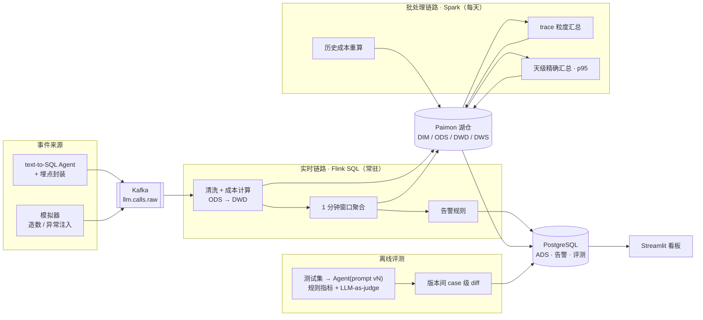

# ai-lakehouse

**LLM 调用可观测性与评测平台**：一个面向大模型应用的流批一体数据平台。采集 Agent 每一次模型调用和工具调用的事件，经 Kafka 实时写入 Paimon 湖仓并分层建模，产出成本、失败、延迟指标和分钟级告警，并把离线评测结果与线上表现按提示词版本关联起来。

> 这是一个个人学习项目，目标是一个能在单台笔记本（MacBook Air M2 / 8GB）上完整跑起来的参考实现，而不是生产系统。

> **当前状态：开发中。** 下文的架构和设计已经确定，代码按 [路线图](#路线图) 逐步实现。"实测结果"一节的数字会在跑通后如实填写。

---

## 它回答什么问题

大模型应用（尤其是 Agent）上线后，团队通常缺少回答下面这些问题的数据：

| 问题 | 对应的指标 |
|---|---|
| 每个功能花了多少钱？ | 按 feature 的成本归因 |
| 完成一个任务总共花多少钱、走了几步？ | trace 粒度汇总 |
| 哪一步最容易失败，是模型、工具还是提示词的问题？ | 首次失败步位、按 span 类型的失败率 |
| 响应慢在哪里？ | p50 / p95 / p99 延迟 |
| 有没有浪费？ | 重试成本占比、缓存命中率 |
| 新版提示词是不是真的更好？ | 离线评测的 case 级 diff × 线上指标 |
| 成本有没有失控？ | 分钟级成本突增、失败率、重试风暴告警 |

## 架构



**流批分工**：流负责"发现异常"，批负责"说清账目"。

- **告警必须流式。** Agent 死循环、重试没设上限、提示词被改长，这类事故几分钟内就能烧掉不少钱。等批处理跑完再发现，损失已经产生。
- **账目走批处理。** trace 汇总需要一次任务的所有 span 都到齐，流式处理乱序和迟到数据代价高、收益低；天级报表要的是准确，全量重算更简单可靠。
- 看板上的天级数字一律读批处理结果；Flink 的分钟级数据只用于告警和实时趋势。

## 技术栈

| 组件 | 选型 | 为什么 |
|---|---|---|
| 消息队列 | Kafka（KRaft） | 事件流的标准方案 |
| 流处理 | Flink SQL | 分钟级告警需要真正的流式；SQL 开发快 |
| 湖仓格式 | Apache Paimon | 与 Flink 集成最好；主键表天然支持去重和更新 |
| 批处理 | Spark SQL | 天级全量重算，生态成熟 |
| 服务层 | PostgreSQL | 看板查询量小，不需要 OLAP 引擎 |
| 看板 | Streamlit | 轻量，纯 Python |
| Agent | OpenAI 兼容 SDK + function calling | 可切换 DeepSeek / 通义 / OpenAI 等模型 |
| 运行环境 | Docker Compose（OrbStack） | 一条命令启动，所有容器限制内存 |

## 关键设计

**1. trace / span 结构是整个项目的核心。**
每次调用都带 `trace_id`、`span_id`、`parent_span_id`。没有它只能回答"平均每次调用多少 token"；有了它才能回答"一个任务总共花多少钱、平均几步、在哪一步失败"。从调用视角转换到任务视角，是这个项目和普通日志系统的根本区别。

**2. 成本不写进事件。**
事件只记录 token 数，成本在 DWD 层用价格维表计算。价格变了或者算错了，可以直接重算历史，不需要重新采集数据。价格维表拆成两张：Flink 用"当前价格"表做 lookup join（每个模型一行，避免关联出重复），批处理用"历史价格"表按生效区间重算。

**3. 埋点集中在客户端封装层。**
Agent 业务代码不直接写埋点。封装层用 `contextvars` 自动传递 trace 上下文；在 `finally` 中发送事件，失败的调用也会记录；使用异步 producer，Kafka 不可用时不影响业务。另外**关闭了 SDK 的内置重试**，由封装自己重试并把每次尝试记成一个 span，否则 SDK 的静默重试不可见，重试率永远显示为 0。

**4. 去重交给 Paimon 主键表。**
Kafka 是至少一次语义，重复事件会落在同一个主键 `(dt, span_id)` 上，被 Paimon 的 `deduplicate` 合并引擎自然去掉，不需要额外的去重算子。

**5. 评测做回归，而不只是打分。**
"这版 85 分"没有行动价值，"这版比上版多挂了 7 个 case，集中在多表 join 的问题"才有。LLM-as-judge 用 50 条人工标注校准一致率，不达标就只看规则指标。最后用 `prompt_version` 把离线评测和线上指标 join 起来，检验"离线更好的版本，线上是否也更好"。

## 数据模型

| 层 | 表 | 粒度 |
|---|---|---|
| DIM | `dim_model_price_hist` / `dim_model_price_current` | 模型 × 生效日期 / 模型 |
| ODS | `ods_llm_call` | 一次调用（原始事件） |
| DWD | `dwd_llm_call` | 一次调用（清洗、去重、算出成本） |
| DWD | `dwd_llm_payload` | 抽样的 prompt 与输出（失败全存、成功抽 1%，TTL 7 天） |
| DWS | `dws_llm_feature_1min` | feature × model × 分钟（实时近似值） |
| DWS | `dws_llm_feature_1d` | feature × model × prompt_version × 天（精确值） |
| DWS | `dws_llm_trace_1d` | 一次任务 |
| ADS | `ads_cost_daily` / `ads_trace_daily` / `ads_eval_vs_online` | 看板维度（PostgreSQL） |

<details>
<summary>事件 schema</summary>

```json
{
  "schema_version": 1,
  "trace_id": "tr_8f3a...",
  "span_id": "sp_01c2...",
  "parent_span_id": "sp_00a1...",
  "span_type": "llm | tool | retrieval",
  "ts_start": "2026-11-19T10:00:00.123Z",
  "ts_end": "2026-11-19T10:00:02.456Z",
  "latency_ms": 2333,
  "feature": "text_to_sql",
  "model": "deepseek-chat",
  "prompt_version": "v2",
  "tool_name": null,
  "input_tokens": 1520,
  "output_tokens": 340,
  "cached_tokens": 800,
  "status": "success | failed | timeout",
  "error_type": "rate_limit | timeout | invalid_output | tool_error | api_error | null",
  "attempt": 1,
  "retry_count": 0,
  "cache_hit": false,
  "prompt_hash": "sha256:...",
  "user_id_hash": "u_7d2e...",
  "env": "prod | dev",
  "source": "agent | simulator"
}
```

字段命名尽量与 OpenTelemetry GenAI 语义约定对应，便于以后迁移。
</details>

## 数据从哪里来

| 来源 | 作用 |
|---|---|
| **text-to-SQL Agent**（真实调用） | 验证埋点在真实场景可用；作为离线评测的被测对象 |
| **模拟器** | 生成几百万条事件做压测；注入死循环、token 暴涨、失败率升高、重试风暴、重复、乱序、坏数据 |
| **公开 LLM trace**（BurstGPT、Azure LLM Inference Trace） | 校准模拟器的请求到达间隔和 token 分布 |
| **Spider / BIRD 子集** | 评测集，SQL 执行结果可以自动判对错 |

两类事件格式完全相同，用 `source` 字段区分。

## 快速开始

> 以下是目标用法，随开发进度逐步可用。

**环境要求**：macOS / Linux，Docker（推荐 OrbStack，内存上限设为 6GB），`make`，Python 3.11 + [uv](https://github.com/astral-sh/uv)，一个 OpenAI 兼容的模型 API Key（只有 Agent 和评测需要）。

```bash
git clone https://github.com/kylerzhu/ai-lakehouse.git
cd ai-lakehouse
cp .env.example .env        # 填入模型 API Key
make setup                  # 启动服务、建表、提交 Flink 作业
```

常用命令：

```bash
make sim-backfill DAYS=30 QPS=50     # 回灌 30 天历史数据
make sim-live QPS=20 INJECT=loop     # 实时造数并注入死循环
make batch DT=2026-11-18             # 跑当天的批处理并导出看板数据
make eval V=v2                       # 用 v2 提示词跑评测
make regress RUN=<new> BASE=<old>    # 输出两个版本的 case 级 diff
make dashboard                       # 打开看板
make down                            # 停止所有服务（数据保留）
```

**资源占用**：常驻服务（Kafka、Flink、PostgreSQL）约 3.3GB 内存；Spark 只在跑批时启动，峰值约 5GB。

## 项目结构

```
infra/                 Flink / Spark 镜像与 SQL 作业、PostgreSQL 初始化
src/llmobs/
  instrumentation/     埋点：trace 上下文、事件 schema、异步 producer、客户端封装
  agent/               text-to-SQL Agent 与各版本提示词
  simulator/           造数与异常注入
  batch/               Spark 批作业：trace 汇总、天级汇总、成本重算、导出 ADS
  eval/                评测、LLM-as-judge 校准、版本回归 diff
  dashboard/           Streamlit 看板
tests/
Claude.md              详细的实施文档（SQL、代码骨架、分阶段验收）
```

## 路线图

- [ ] **Phase 0 · 环境**：Docker Compose 跑通 Kafka、Flink、Spark、PostgreSQL，Flink 与 Spark 读写同一张 Paimon 表
- [ ] **Phase 1 · 埋点与造数**：客户端封装、工具装饰器、模拟器与异常注入
- [ ] **Phase 2 · 实时链路**：Kafka → Flink → Paimon ODS/DWD，分钟级聚合
- [ ] **Phase 3 · 告警**：成本突增、失败率、重试风暴、延迟劣化四条规则
- [ ] **Phase 4 · Agent、批处理与评测**：text-to-SQL Agent，trace 汇总，版本回归 diff
- [ ] **Phase 5 · 看板与实测**：Streamlit 看板，一键启动，记录实测数字

## 验证清单

| 验证项 | 状态 |
|---|---|
| 重复发送同一 `span_id`，DWD 不出现重复行 | ⬜ |
| 延迟 30 秒到达的事件仍归入正确的窗口 | ⬜ |
| 修改价格维表后重算历史，成本相应变化 | ⬜ |
| 人为制造死循环（一个 trace 50 次调用），成本告警触发 | ⬜ |
| Flink 重启后从 checkpoint 恢复，不重不漏 | ⬜ |
| 批处理重跑同一天，结果幂等 | ⬜ |
| Kafka 不可用时 Agent 仍正常返回 | ⬜ |

## 实测结果

> 跑通后填写，全部为真实测量值。

| 指标 | 数值 |
|---|---|
| 处理事件总数 | 待测 |
| Flink 稳定吞吐 | 待测 |
| 事件从发出到可查询的端到端延迟 | 待测 |
| 注入异常到产生告警的时间 | 待测 |
| 批作业全量重算耗时 | 待测 |
| 峰值内存占用 | 待测 |
| 评测：v1 → v2 执行结果正确率 | 待测 |

## 后续方向

1. 用 LangGraph 重写 Agent，通过 callback 机制采集事件
2. 实时 p95（Flink UDAF + t-digest）
3. 数据质量监控：字段缺失率、trace 断链率
4. 成本优化建议：识别可缓存的重复 prompt、可降级到小模型的简单请求
5. 迁移到 OpenTelemetry SDK + Collector

## 参考

- [Apache Paimon](https://paimon.apache.org/)、[Apache Flink](https://flink.apache.org/)
- [git-raka/iceberg-ai-lakehouse](https://github.com/git-raka/iceberg-ai-lakehouse)：架构参考，借鉴了它的 Compose 资源限制、调用网关、模拟器与评测写法
- [OpenTelemetry GenAI 语义约定](https://opentelemetry.io/docs/specs/semconv/gen-ai/)
- [BurstGPT](https://github.com/HPMLL/BurstGPT)、[Azure Public Dataset](https://github.com/Azure/AzurePublicDataset)
- [Spider](https://yale-lily.github.io/spider)、[BIRD](https://bird-bench.github.io/)
