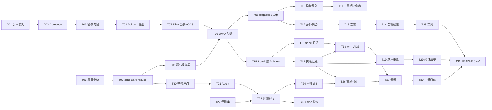

# 开发工作流与任务拆分

> 本文把 [README.md](README.md) 的目标和 [Claude.md](Claude.md) 的实施方案拆成可以逐个完成的任务块，按优先级和依赖关系排序。
> 技术细节（SQL、代码骨架、表结构）以 `Claude.md` 为准，本文只管**做什么、按什么顺序、做到什么程度算完成**。

---

## 1. 拆分原则

1. **先打通一条最细的端到端链路，再加宽。** 第一个里程碑只要"一条事件从 Python 发出，最终出现在 Paimon 的 DWD 表里"。成本计算、告警、批处理都建立在这条链路上。
2. **风险最高的先做。** Flink 与 Paimon 的版本匹配、两个引擎共享同一个 warehouse，是最可能卡住的地方，放在最前面验证。
3. **每个任务都有可执行的验收标准。** 验收必须实际运行并看到结果，不凭推断宣布完成。
4. **每个任务控制在半天到一天半。** 超过的继续拆。
5. **能并行的标出来。** 等 Flink 作业调试时，可以同时写不依赖它的 Python 代码。

## 2. 优先级定义

| 级别 | 含义 | 不做的后果 |
|---|---|---|
| **P0** | 关键路径：没有它项目不成立 | 项目无法演示 |
| **P1** | 核心价值：简历和面试上要讲的点 | 项目只是一条普通的数据管道 |
| **P2** | 完整度：让项目可信、可复现 | 别人跑不起来，数字没有说服力 |
| **P3** | 扩展：有余力再做 | 无 |

---

## 3. 里程碑总览

| 里程碑 | 内容 | 包含任务 | 预计 | 完成标志 |
|---|---|---|---|---|
| **M0 环境** | 容器跑通，Flink 与 Spark 读写同一张 Paimon 表 | T01 – T04 | 2 天 | 冒烟测试通过 |
| **M1 最小链路** | Python 发事件 → Kafka → Flink → Paimon DWD | T05 – T08 | 3 天 | DWD 表持续增长 |
| **M2 实时价值** | 成本计算、去重、乱序、分钟聚合、告警 | T09 – T14 | 4 天 | 注入异常 2 分钟内出告警 |
| **M3 批处理** | trace 汇总、天级汇总、ADS、成本重算 | T15 – T19 | 3 天 | 批处理幂等，改价后成本变化 |
| **M4 Agent 与评测** | 完整埋点、text-to-SQL Agent、版本回归 | T20 – T26 | 4 天 | 输出 v1 vs v2 diff 报告 |
| **M5 交付** | 看板、实测、一键启动、文档 | T27 – T31 | 3 天 | 干净目录 `make setup` 跑通 |
| **M6 扩展** | 可选增强 | T32 – T36 | — | — |

合计约 19 个工作日（按每天 4 到 6 小时）。M4 中的 Python 部分可以和 M2、M3 并行，实际可压缩到 3 周左右。

---

## 4. 依赖关系



**关键路径**：T01 → T02 → T03 → T04 → T07 → T08 → T09 → T12 → T13 → T15 → T16 → T18 → T27 → T30 → T31

**可并行的支线**：
- T05、T06 可以在 T02 到 T04 期间做（纯 Python，不依赖容器）
- T20 到 T25 可以在 M2、M3 期间做（只需要 Kafka 和模型 API Key）
- T22 准备评测集随时可做

---

## 5. 任务清单

格式说明：**优先级 · 预计时长 · 依赖**。时长以"天"计，1 天约 4 到 6 小时。

### M0 环境

#### T01 核对组件版本 `P0 · 0.5 天 · 无`
- **做什么**：在 Maven Central 与 Paimon 官方文档的兼容矩阵中，确定 Flink 1.20.x、Paimon（Flink 与 Spark 两个 jar）、Spark 3.5.x、Flink Kafka connector、Flink JDBC connector、PostgreSQL JDBC 驱动的确切版本。
- **产出**：`Claude.md` 第 1.3 节填入确切版本号；一份 jar 下载地址清单。
- **验收**：每个 jar 的 URL 都能下载（`curl -I` 返回 200）。
- **风险**：这是全项目最容易卡住的地方。不确定时选 Paimon 文档"快速开始"里使用的版本组合。

#### T02 编写 docker-compose 与 Makefile `P0 · 0.5 天 · T01`
- **做什么**：kafka（KRaft，带 `localhost:9094` 外部 listener）、flink-jobmanager、flink-taskmanager、postgres 常驻；spark 放在 `profiles: [batch]`。全部设置 `mem_limit` 和健康检查，端口只绑定 `127.0.0.1`。Flink 与 Spark 挂载同一个 volume 到 `/data/paimon`。
- **产出**：`docker-compose.yml`、`.env.example`、`Makefile`（`up` / `down` / `clean` / `status` / `logs` / `topics`）。
- **验收**：`make up` 后 `make status` 显示所有常驻服务 healthy；`docker stats` 总内存低于 3.5GB。

#### T03 构建 Flink 与 Spark 镜像 `P0 · 0.5 天 · T02`
- **做什么**：Flink Dockerfile 用 wget 下载 Paimon、Kafka、JDBC jar 到 `/opt/flink/lib`；Spark Dockerfile 加入 paimon-spark jar 和 `spark-defaults.conf`。参考 `iceberg-ai-lakehouse` 的 `infra/flink/Dockerfile` 写法。
- **产出**：`infra/flink/Dockerfile`、`infra/spark/Dockerfile`、`infra/spark/spark-defaults.conf`。
- **验收**：镜像在 arm64 上构建成功；Flink Web UI（`localhost:8081`）可以打开。

#### T04 Paimon 冒烟测试 `P0 · 0.5 天 · T03`
- **做什么**：在 Flink SQL Client 中创建 Paimon catalog 和一张测试主键表，写入几行（包括重复主键）并读出；然后用 Spark SQL 读同一张表。
- **产出**：`infra/flink/sql/00_catalog.sql`；`make flink-sql`、`make spark-sql` 两条命令。
- **验收**：Flink 写入的数据 Spark 能读到；重复主键只保留一行。
- **🏁 M0 完成**

### M1 最小链路

#### T05 Python 项目骨架 `P0 · 0.5 天 · 无（可与 M0 并行）`
- **做什么**：`uv init`，Python 3.11；按 `Claude.md` 第 2 节建立 `src/llmobs/` 目录；配置 ruff 和 pytest。
- **产出**：`pyproject.toml`、目录结构、`make test`。
- **验收**：`make test` 能运行（哪怕只有一个空测试）。

#### T06 事件 schema 与异步 producer `P0 · 1 天 · T05`
- **做什么**：`instrumentation/schema.py` 定义事件 dataclass、默认值、校验、`latency_ms` 计算、prompt hash；`instrumentation/producer.py` 实现 `emit()`，key 用 `trace_id`，发送失败只记日志。
- **产出**：两个模块及单元测试。
- **验收**：单元测试覆盖：缺必填字段时拒绝；Kafka 不可用时 `emit()` 不抛异常；序列化后的 JSON 与 `Claude.md` 第 3 节一致。

#### T07 Flink Kafka 源表与 ODS `P0 · 1 天 · T04`
- **做什么**：Kafka 源表（含 `proc_time` 和 30 秒 watermark），ODS append 表，作业提交脚本（`envsubst` 替换占位符）。
- **产出**：`infra/flink/sql/02_ods_dwd.sql`（ODS 部分）、`infra/flink/submit.sh`、`make flink-submit`。
- **验收**：用 `kafka-console-producer` 手工发几条 JSON，ODS 表中能查到。

#### T08 最小模拟器 + DWD 入湖 `P0 · 1 天 · T06, T07`
- **做什么**：最小版模拟器，只有 1 个 feature、固定步数、正常数据，按 trace 结构生成事件并通过 `emit()` 发送；Flink 写入 DWD 主键表（此时成本字段可以先为 NULL）。
- **产出**：`simulator/run.py`（`live` 模式）、DWD 建表和写入 SQL、`make sim-live`。
- **验收**：模拟器运行 5 分钟，DWD 行数持续增长；用 `trace_id` 查询能看到完整的 span 树，parent 关系正确。
- **🏁 M1 完成：最小端到端链路打通。** 建议在这里提交一次，并在 README 路线图勾选 Phase 0。

### M2 实时价值

#### T09 价格维表与成本计算 `P0 · 1 天 · T08`
- **做什么**：建立 `dim_model_price_hist` 与 `dim_model_price_current`，写入初始价格；清洗视图 `v_call_enriched` 通过 lookup join 计算 `cost_usd`。
- **产出**：`infra/flink/sql/01_dim.sql`、价格初始化脚本、更新后的 DWD 写入逻辑。
- **验收**：抽 5 条 DWD 记录手工核算成本，结果一致；未知模型的成本为 NULL 而不是报错。

#### T10 模拟器扩展：多 feature 与异常注入 `P1 · 1 天 · T08`
- **做什么**：`profiles.py` 定义 3 个 feature 的步数、token、延迟、失败率分布；`anomalies.py` 实现 `loop`、`token-spike`、`fail-rate`、`retry-storm`、`dup-rate`、`late-rate`、`bad-rate`；增加 `backfill` 模式。
- **产出**：完整模拟器、对应的 Makefile 参数。
- **验收**：每个开关单独运行，在 Kafka 中能观察到对应的数据特征。

#### T11 去重与乱序验证 `P1 · 0.5 天 · T09, T10`
- **做什么**：用 `--dup-rate 0.05` 和 `--late-rate 0.05 --late-sec 30` 运行，验证 DWD 去重和 watermark 行为；学习并记录 checkpoint、主键表合并、bucket 的作用。
- **产出**：验证脚本（比较模拟器发送的唯一 span 数与 DWD 行数）；学习笔记写进 `docs/notes.md`。
- **验收**：DWD 行数 = 唯一 span 数；验证清单第 1、2 项打勾。

#### T12 分钟级聚合 `P0 · 1 天 · T09`
- **做什么**：TUMBLE 窗口聚合写入 `dws_llm_feature_1min`；所有 INSERT 合并为一个 `STATEMENT SET`。
- **产出**：`infra/flink/sql/03_dws_alert.sql`（聚合部分）。
- **验收**：每分钟产生新窗口行；手工对比某一分钟的 `call_cnt` 与 DWD 中同窗口的计数（流式未去重，允许有少量偏差）。

#### T13 告警规则 `P0 · 1 天 · T12`
- **做什么**：Postgres `alert_event` 表；Flink JDBC sink；OVER 窗口计算 1 小时基线；四条规则。
- **产出**：`infra/postgres/init.sql`（告警部分）、告警 SQL。
- **验收**：作业稳定运行，正常数据下不产生告警。
- **退路**：OVER 窗口调试超过 1 天仍不通，改为 Flink 把分钟聚合写入 Postgres，Python 进程每分钟判断。README 中说明这个取舍。

#### T14 告警验证 `P1 · 0.5 天 · T10, T13`
- **做什么**：分别注入四种异常，记录从注入到告警出现的时间。
- **产出**：验证记录（时间、规则、观测值、基线）。
- **验收**：四种异常都在 2 分钟内产生告警；验证清单第 4 项打勾。
- **🏁 M2 完成。** README 路线图勾选 Phase 2、Phase 3。

### M3 批处理

#### T15 Spark 读写 Paimon 的作业框架 `P0 · 0.5 天 · T08`
- **做什么**：PySpark 作业模板（SparkSession、Paimon catalog、参数 `--dt`）；`make batch DT=...` 用 `docker compose run --rm` 运行。
- **产出**：`batch/common.py`、Makefile 命令。
- **验收**：作业能读取 DWD 某一天的数据并打印行数，退出后容器自动删除。

#### T16 trace 粒度汇总 `P0 · 1 天 · T15`
- **做什么**：实现 `dws_llm_trace_1d`，包括跨天 trace 的处理、`MIN_BY` 修正后的 `first_fail_type`、`final_success` 列。
- **产出**：`batch/dws_trace_1d.py`。
- **验收**：用模拟器 backfill 的数据运行；手工构造一个已知结构的 trace（第 3 步工具失败）核对各列；同一天重跑两次结果一致。

#### T17 天级精确汇总 `P1 · 0.5 天 · T15`
- **做什么**：`dws_llm_feature_1d`，含 p50 / p95 / p99、重试成本占比、缓存命中率，维度包括 `prompt_version`。
- **产出**：`batch/dws_feature_1d.py`。
- **验收**：与 DWD 直接聚合的结果一致；重跑幂等。

#### T18 导出 ADS 到 Postgres `P0 · 0.5 天 · T16, T17`
- **做什么**：按 dt 先删后写的方式导出 `ads_cost_daily`、`ads_trace_daily`。
- **产出**：`batch/export_ads.py`、ADS 建表语句。
- **验收**：重跑后 Postgres 中没有重复行；验证清单第 6 项打勾。

#### T19 历史成本重算 `P1 · 0.5 天 · T17`
- **做什么**：`reprice.py` 按 `dim_model_price_hist` 的生效区间重算 DWD 的 `cost_usd`，然后重跑 T16 到 T18。
- **产出**：`batch/reprice.py`、`make reprice`。
- **验收**：修改某个模型的历史价格并重算，ADS 中对应日期的成本按预期变化；验证清单第 3 项打勾。
- **🏁 M3 完成。**

### M4 Agent 与评测（Python 部分可与 M2、M3 并行）

#### T20 完整埋点封装 `P1 · 1 天 · T06`
- **做什么**：`context.py`（contextvars）、`client.py`（关闭 SDK 重试、自行重试、每次尝试一个 span、捕获所有异常）、`tools.py`（`@traced_tool`、`@traced_retrieval`）、抽样 payload 发送。
- **产出**：`instrumentation/` 完整模块与单元测试。
- **验收**：单元测试覆盖：异常时仍发事件；重试 2 次产生 3 个 span 且 `attempt` 递增；嵌套工具调用的 `parent_span_id` 正确；Kafka 停止时业务调用正常返回（验证清单第 7 项）。

#### T21 text-to-SQL Agent `P1 · 1 天 · T20`
- **做什么**：从 Spider 或 BIRD 选 2 到 3 个 SQLite 数据库；实现 `list_tables`、`describe_table`、`run_sql`（只读）三个工具；function calling 循环，最多 6 步；提示词 `v1.md`。
- **产出**：`agent/`、`make agent Q="..."`。
- **验收**：10 个问题中能正确回答大部分；每次运行在 DWD 中产生 `source=agent` 的完整 trace。

#### T22 准备评测集 `P1 · 0.5 天 · 无（随时可做）`
- **做什么**：从 Spider / BIRD 中抽取与 T21 数据库对应的 100 到 200 条问题和标准 SQL，统一为 JSONL；另选 50 条留作人工标注。
- **产出**：`data/eval/testset_v1.jsonl`（不入库，在 README 中说明获取方式）、数据准备脚本。
- **验收**：每条的标准 SQL 都能在对应数据库上执行成功。

#### T23 评测执行 `P1 · 1 天 · T21, T22`
- **做什么**：`run_eval.py` 对指定 prompt_version 跑测试集，计算 SQL 可执行率、结果一致率、步数、成本；写入 `eval_run`、`eval_case`（含 `trace_id`）。
- **产出**：`eval/run_eval.py`、评测相关表、`make eval V=...`。
- **验收**：先用 20 条跑通再跑全量；v1 的结果写入 Postgres。

#### T24 版本回归 diff `P1 · 0.5 天 · T23`
- **做什么**：根据 v1 的失败 case 写出 `v2.md`；`regress.py` 对比两个 run，输出 fixed / broken / same 分类和 Markdown 报告。
- **产出**：`eval/regress.py`、`agent/prompts/v2.md`、`make regress`。
- **验收**：报告中列出变好和变差的 case，并按问题类型归类。

#### T25 judge 与校准 `P2 · 1 天 · T23`
- **做什么**：`judge.py` 对最终回答打 1 到 5 分；人工标注 50 条；计算一致率（分差 ≤1 的比例或 Cohen's kappa）。
- **产出**：`eval/judge.py`、`judge_calibration` 表、一致率报告。
- **验收**：一致率有明确数字；低于 0.7 时报告中注明 judge 结论不采信。

#### T26 离线评测 × 线上指标 `P1 · 0.5 天 · T17, T24`
- **做什么**：`ads_eval_vs_online`：按 `prompt_version` 关联 `eval_run` 与 `dws_llm_feature_1d`。需要让两个版本的 Agent 都产生一定量的线上数据（可以用评测外的问题跑一批）。
- **产出**：ADS 表与导出逻辑。
- **验收**：能回答"v2 离线通过率更高，线上失败率和单次成本是否也更好"。
- **🏁 M4 完成。** README 路线图勾选 Phase 4。

### M5 交付

#### T27 Streamlit 看板 `P1 · 1 天 · T18, T26`
- **做什么**：五个页面：成本、任务、延迟、告警、评测。只读 Postgres。
- **产出**：`dashboard/app.py`、`make dashboard`。
- **验收**：每个页面在 backfill 数据上都有内容；截图放入 `docs/images/`。

#### T28 实测与压测 `P2 · 0.5 天 · T14`
- **做什么**：`make bench` 以固定 QPS 发送 N 条事件；记录 Flink 稳定吞吐、端到端延迟、峰值内存、批作业耗时、告警时延。
- **产出**：`make bench`、测量记录。
- **验收**：README"实测结果"表中所有"待测"都替换为真实数字（验证清单第 8 项）。

#### T29 验证清单收尾 `P2 · 0.5 天 · T19, T20`
- **做什么**：逐条执行 `Claude.md` 第 12 节的验证清单，重点补上第 5 项（Flink 重启后不重不漏）。
- **产出**：README 验证清单全部更新状态。
- **验收**：每一项都有实际执行记录。

#### T30 一键启动 `P2 · 0.5 天 · T27`
- **做什么**：`make setup` 串起启动、建 topic、建表、初始化价格、提交作业、backfill、跑批、启动看板。
- **产出**：完善的 Makefile。
- **验收**：在一个全新的目录中 `git clone` 后执行 `make setup` 能完整跑通。

#### T31 README 定稿 `P2 · 0.5 天 · T28, T29, T30`
- **做什么**：去掉"开发中"标记；"快速开始"改为实际可用的步骤；加入看板截图；在设计取舍部分补充开发中遇到的问题和解决方式。
- **产出**：最终版 README、LICENSE。
- **验收**：一个没看过项目的人能只靠 README 跑起来并理解设计。
- **🏁 M5 完成：项目可交付。**

### M6 扩展（P3，按价值排序）

| 任务 | 内容 |
|---|---|
| T32 | 用 LangGraph 重写 Agent，通过 callback 采集事件，与自写封装对比 |
| T33 | 数据质量监控：字段缺失率、trace 断链率 |
| T34 | 成本优化建议：重复 `prompt_hash`、可降级到小模型的简单请求 |
| T35 | 实时 p95：Flink UDAF + t-digest |
| T36 | 迁移到 OpenTelemetry SDK + Collector |

---

## 6. 建议排期

| 周 | 主线 | 并行支线 | 周末检查点 |
|---|---|---|---|
| 第 1 周 | T01 – T04（M0），T07 – T09 | T05、T06、T22 | M1 完成，DWD 有成本 |
| 第 2 周 | T10 – T14（M2），T15 – T16 | T20、T21 | M2 完成，trace 汇总可用 |
| 第 3 周 | T17 – T19（M3），T23 – T26（M4） | T25 | M3、M4 完成 |
| 第 4 周（缓冲） | T27 – T31（M5） | — | 项目可交付 |

如果进度落后，**优先砍 P2 和 P3**，保证 P0、P1 全部完成。P1 中最后才考虑砍的是 T16（trace 汇总）和 T24（版本回归），它们是项目区别于普通数据管道的地方。

---

## 7. 每个任务的工作流程

### 7.1 开始前
1. 确认依赖任务已完成并通过验收。
2. 从 `main` 切出分支：`git checkout -b t09-price-dim`（`t` + 任务编号 + 简短描述）。
3. 重读 `Claude.md` 中对应章节。

### 7.2 进行中
- 小步提交，提交信息格式：`T09: 价格维表与 lookup join`。
- 遇到与 `Claude.md` 设计不一致的情况，先改设计文档，再改代码，并在提交信息中说明原因。
- 一个任务超过预计时长的 2 倍仍未完成，停下来重新评估：拆分、换方案，或启用文档中的退路。

### 7.3 完成标准（Definition of Done）
- [ ] 验收标准中的每一条都**实际运行过**并看到结果
- [ ] 新增的 Python 代码有单元测试，`make test` 通过
- [ ] 没有提交 `.env`、密钥、数据文件
- [ ] 容器内存仍在预算内（`docker stats` 检查）
- [ ] 对应的 Makefile 命令可用
- [ ] 本文任务状态表已更新；完成里程碑时同步更新 README 路线图和验证清单
- [ ] 合并回 `main` 并推送

### 7.4 每次结束工作时
```bash
make down        # 释放内存
git push         # 推送当天进度
```

---

## 8. 风险与应对

| 风险 | 可能性 | 影响 | 应对 |
|---|---|---|---|
| Flink / Paimon / Spark 版本不兼容 | 高 | 阻塞 M0 | T01 优先做；采用 Paimon 文档示例中的版本组合 |
| 8GB 内存不够，频繁 swap | 中 | 开发变慢 | Spark 按需启动；压测时关闭其他应用；必要时用 Flink Batch 替代 Spark |
| Flink OVER 窗口告警调不通 | 中 | M2 延期 | 启用 Python 告警退路 |
| 模型 API 费用超预期 | 低 | 评测受限 | 先用 20 条跑通；选择便宜模型；评测结果缓存 |
| 评测集与 Agent 数据库不匹配 | 中 | M4 延期 | T22 尽早做，先确认数据库再写 Agent |
| 进度拖延 | 中 | 无法交付 | 按第 6 节规则砍 P2、P3 |

---

## 9. 任务状态

> 每完成一个任务就更新这一节。状态：⬜ 未开始 · 🟡 进行中 · ✅ 完成 · ⏸ 暂缓

| 任务 | 名称 | 优先级 | 预计 | 状态 |
|---|---|---|---|---|
| T01 | 核对组件版本 | P0 | 0.5 | ⬜ |
| T02 | docker-compose 与 Makefile | P0 | 0.5 | ⬜ |
| T03 | Flink 与 Spark 镜像 | P0 | 0.5 | ⬜ |
| T04 | Paimon 冒烟测试 | P0 | 0.5 | ⬜ |
| T05 | Python 项目骨架 | P0 | 0.5 | ⬜ |
| T06 | 事件 schema 与 producer | P0 | 1 | ⬜ |
| T07 | Flink 源表与 ODS | P0 | 1 | ⬜ |
| T08 | 最小模拟器 + DWD | P0 | 1 | ⬜ |
| T09 | 价格维表与成本计算 | P0 | 1 | ⬜ |
| T10 | 模拟器多 feature 与异常注入 | P1 | 1 | ⬜ |
| T11 | 去重与乱序验证 | P1 | 0.5 | ⬜ |
| T12 | 分钟级聚合 | P0 | 1 | ⬜ |
| T13 | 告警规则 | P0 | 1 | ⬜ |
| T14 | 告警验证 | P1 | 0.5 | ⬜ |
| T15 | Spark 作业框架 | P0 | 0.5 | ⬜ |
| T16 | trace 粒度汇总 | P0 | 1 | ⬜ |
| T17 | 天级精确汇总 | P1 | 0.5 | ⬜ |
| T18 | 导出 ADS | P0 | 0.5 | ⬜ |
| T19 | 历史成本重算 | P1 | 0.5 | ⬜ |
| T20 | 完整埋点封装 | P1 | 1 | ⬜ |
| T21 | text-to-SQL Agent | P1 | 1 | ⬜ |
| T22 | 评测集准备 | P1 | 0.5 | ⬜ |
| T23 | 评测执行 | P1 | 1 | ⬜ |
| T24 | 版本回归 diff | P1 | 0.5 | ⬜ |
| T25 | judge 与校准 | P2 | 1 | ⬜ |
| T26 | 离线 × 线上关联 | P1 | 0.5 | ⬜ |
| T27 | Streamlit 看板 | P1 | 1 | ⬜ |
| T28 | 实测与压测 | P2 | 0.5 | ⬜ |
| T29 | 验证清单收尾 | P2 | 0.5 | ⬜ |
| T30 | 一键启动 | P2 | 0.5 | ⬜ |
| T31 | README 定稿 | P2 | 0.5 | ⬜ |
